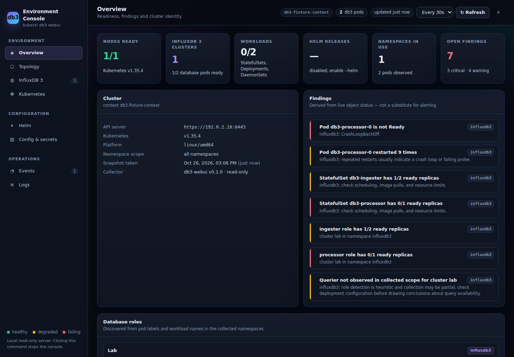
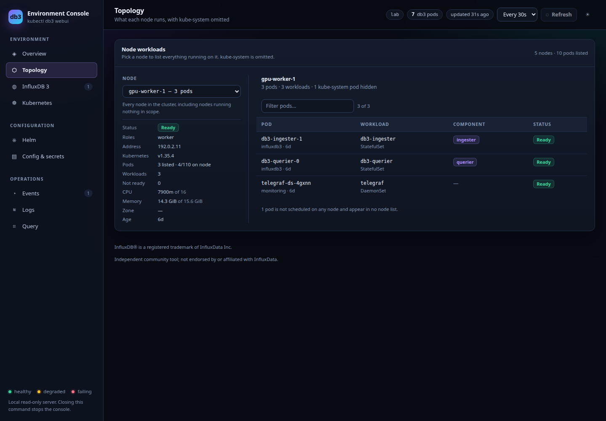
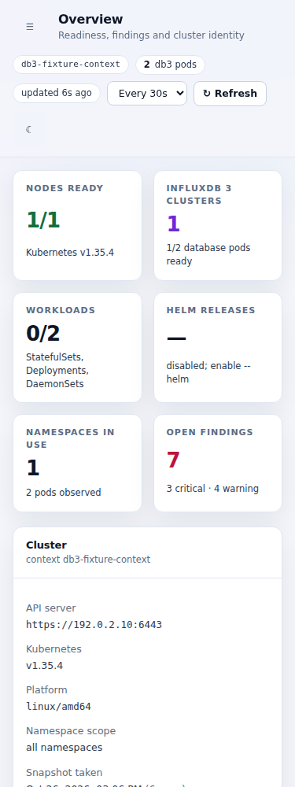
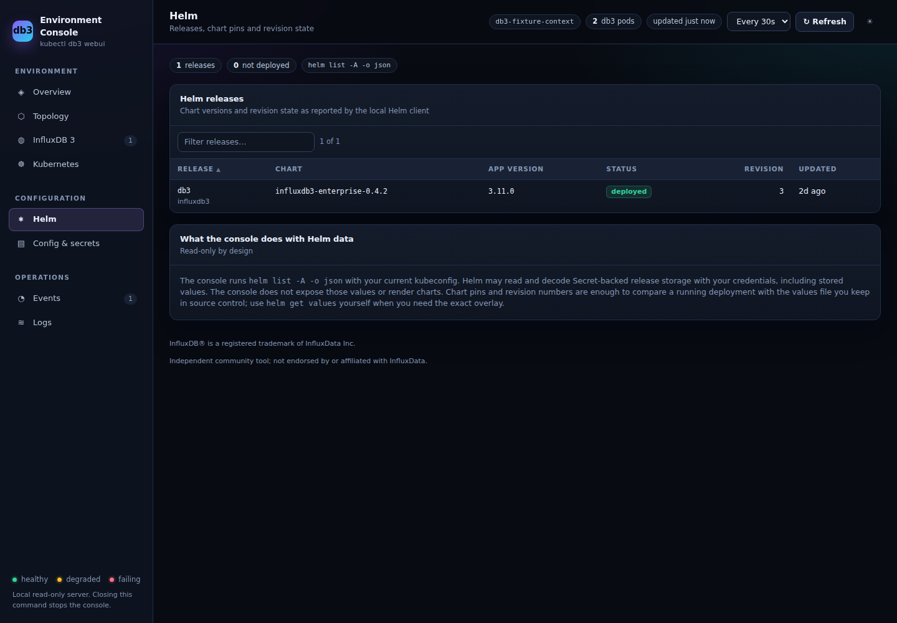

# PR2 integration verification

This integrates security/build work into PR2's existing std/tiny_http server,
collector module, singlefile React app, API and eight views. It does not add a
second dashboard or replace the support capture implementation.

## Security defaults and fidelity

- Loopback binding only, port 9191 by default, custom/ephemeral ports retained.
- Per-run 256-bit random session in the `db3-session` meta bootstrap; every
  `/api/*` request requires `X-DB3-Session`. Exact printed Host authority and
  same-origin Origin checks use the actual bound port. No token URLs/CORS.
- Inline module script receives a server nonce. Script-like string literals
  inside React are not rewritten. Style unsafe-inline remains intentional.
- Neither direct Secret collection nor Helm runs by default.
  `--include-secret-metadata` opts into direct Secret reads; independent `--helm`
  opts into Helm storage reads/decoding, which may include full Secret-backed
  releases under operator credentials. `--no-secrets` conflicts with both
  opt-ins. Base RBAC still has no Secret/write/exec grants.
- Opaque ConfigMap/env/command values are hidden after derived DB observations
  are calculated. Raw collector stderr never reaches error/log responses.
- WebUI-only bounded/cancellable process supervision uses safe rustix WNOWAIT
  to retain process-group leader ownership until kill-group, then direct-child
  wait/reap. Successful leaders' background descendants are also cleaned up.
- Configuration: sequential single-job processing, at most 16 namespaces,
  500 combined ConfigMap/Secret metadata rows and 1 MiB serialized masked rows.
  Truncated outcomes preserve bounded data AND propagate partial errors.
- Resource arrays: 500 entries per type; backend selector comparisons: 50,000.
  Topology: every collected node with no separate node cap, pods bucketed by node
  from the full collected set, paged rather than sliced, with `kube-system`
  omitted and counted and unscheduled pods reported separately. Visible partial
  findings/notices; owner kind/name + namespace only, never inferred ownership
  from same-role labels. Missing querier observations are explicitly uncertain
  rather than assertions that SQL must fail.
- Light success foreground darkened after a measured 4.35:1 regression;
  narrow key/value layouts now stack, theme/menu touch targets are 44px.

## Observed local verification

All commands below passed on the integration worktree, with Node 22.23.4:

```sh
cd webui
npm ci
npm test                       # 20 tests, four files, Vitest 5.0.5
npm run typecheck
npm run build                  # Vite 6.4.5, one embedded index.html
npm run check:reproducible      # two rebuilds compared byte-for-byte
npm audit                      # zero vulnerabilities, including dev dependencies
cd ..
cargo fmt --check
cargo clippy --locked --all-targets -- -D warnings
cargo test --locked            # 5 unit / 12 native / 27 real-HTTP WebUI tests
cargo test --locked --release  # same suites passed
cargo doc --locked --no-deps
cargo build --locked --release
DB3_BINARY="$PWD/target/release/kubectl-db3" python3 -m unittest discover -s tests -v
# 20 existing compatibility tests passed; fixture timing changes were unnecessary.
python3 scripts/webui_fixture.py target/review-blockers-final-smoke --binary target/release/kubectl-db3
# 12 synthetic JSON fixtures; real shell/auth snapshot/DB derivation/SIGTERM/port-release passed.
git diff --check
```

The workflow passed the supplied checksum-verified actionlint 1.7.12 again after
the final fixes; its npm and Rust command paths were also exercised locally.
Singlefile SHA-256:
`27ff675d94e820b112808a85af27af044403c8a150992e4b619bc9798727ea71`.
Both original LICENSE.md and THIRD_PARTY_NOTICES.md are preserved verbatim in
an inert template inside the HTML; the reproducibility script checks this.
CI checks source/dist equality against the committed artifact. Its remote result
is separate from the local command evidence above.

RED then GREEN was observed for auth, default Secret/value privacy, active
child-group shutdown, incomplete-header idle expiry, output bounds, resource
bounds, frontend authenticated API, light contrast/mobile layout, trademark
copy, configuration copy, topology ownership and graph limits. The successful
leader/redirected-background-child test is an additional passing regression for
the WNOWAIT design, not a claimed failure of code that already used WNOWAIT.
A served-shell regression also caught and fixed broad nonce replacement inside
React's script-string literals and accidental session replacement in JS checks.

## Remaining review blockers: observed RED → GREEN

- Slow body framing reproduced the shutdown hang: Content-Length 2048 with a
  one-byte body and 200 ms writes kept the server alive past the four-second
  SIGINT bound. Feature-gated rejection now precedes Request/data-reader
  creation. The matrix covers SIGINT and SIGTERM, huge/malformed/positive
  lengths, absent initial body bytes and chunked framing; bodyless GET/HEAD
  including Content-Length 0 still work. Header-budget regression initially
  returned 200, now 400. Limits: 8 KiB per request/header line, 32 KiB header
  section, 64 fields; these do not impose an absolute trickle deadline.
- Fake Helm call logging caught default invocation. Defaults and direct Secret
  metadata opt-in now make no Helm call; `--helm` returns actual fixture
  releases independently. Explicit `--no-secrets --helm` initially started
  serving, now is a usage error (the first unbounded test attempt timed out;
  it was replaced by a bounded child test before the failing assertion run).
- 501 ConfigMaps and 501 opt-in Secret metadata objects initially yielded
  configuration ok=true despite per-resource truncation. Both now retain
  bounded data and visible partial errors. Separate namespace/combined-row/byte
  caps pass. A further RED caught masking growing a short-value configuration
  to 1,055,858 bytes after a pre-mask budget check; budgeting the masked row now
  keeps the actual returned representation within 1 MiB. HTTP test decoding
  was corrected to decode chunk framing as bytes before UTF-8 conversion.
- An unrelated same-role StatefulSet inserted first stole desired=99 instead
  of the observed owner's desired=2. Kind/name/namespace ownership now passes;
  ambiguous references initially chose arbitrarily, now remain unknown.
  Additional checks cover owner deduplication, summed verified distinct owners,
  namespace separation and ReplicaSet ancestry resolved through the recorded
  ReplicaSet owner rather than left uninferred.
- Empty/failed-source Overview initially claimed every object healthy; the
  React regression now passes with observation-bounded wording, and the Helm
  view explicitly says disabled rather than reporting no releases.

The vendored crate's feature-OFF library tests passed (10, including a real
body-bearing request compatibility control); feature-ON library tests passed
(9). Full application checks below include the original idle-listener retry
and two-second incomplete-header idle regressions. No base RBAC change was
needed for these blockers.

## Reusable fixture / browser handoff

A fresh fixture directory can be exported without starting a server:

```sh
python3 scripts/webui_fixture.py target/my-browser-fixture
PATH="$PWD/target/my-browser-fixture:/usr/bin:/bin" \
KUBECONFIG="$PWD/target/my-browser-fixture/unused-kubeconfig" \
  target/release/kubectl-db3 webui --port 0 --context fixture
```

The exporter refuses an existing target directory. Open the printed authority
exactly; the UI reads its session meta automatically. Ctrl+C stops this manual
fixture server. Add `--include-secret-metadata` only for direct Secret metadata and `--helm`
only for actual Helm fixture releases; both are independent explicit opt-ins.
No real kubeconfig or cluster is needed. Baseline navigation labels and hash
routes remain Overview, Topology, InfluxDB 3, Kubernetes, Helm, Config & secrets,
Events, Logs.

API shapes remain in `webui/src/types.ts`:
- `/api/health`: `{ok, version}`.
- `/api/snapshot[?refresh=1]`: the original Snapshot object, including `pods`,
  `db3`, `nodes`, `workloads`, `services`, `storage`, `helm`, `configmaps`,
  `secrets`, `events`, `issues`, `collectors` and cluster/context metadata.
  The optional `helm_enabled` flag distinguishes disabled from empty; unknown
  role owner capacity is represented by null `desired`/`workload`, not guessed.
- `/api/logs?namespace=&pod=&container=&tail=`: original `{namespace, pod,
  container, tail, redacted, error, lines}` with validated names/clamped tail.
- `/api/manifest`: YAML, not JSON. All API routes require the session header.

## Parent final served-surface and manifest checks

After all review fixes, the final singlefile with the SHA-256 above was served
by the isolated installed Rust binary at default port 9191 and freshly captured
in both themes at 1440/768/375. All eight views and primary interactions were
exercised again. The default Helm-disabled state was checked explicitly; a
separate run with `--helm --port 9292` rendered the synthetic release summary.
These are actual rendered/runtime receipts with synthetic inputs, not production
cluster or real Helm-storage evidence. The screenshots below are from this final
artifact, not the earlier implementation or baseline.

After the blocker-fix UI edits, the actual installed Rust binary served the built
singlefile at the default port 9191 using explicitly synthetic kubectl/Helm
fixtures. Both themes were captured at 1440, 768 and 375 pixels. No page-level
overflow, page/runtime/CSP errors, external runtime requests, or axe WCAG 2 A/AA
and 2.1 AA violations were observed on those six overview states. Navigation
through all eight views, configuration disclosure/value hiding, actual
session-authenticated log fetch, persisted theme after reload, mobile navigation
and table search, refresh/poll controls, and real Ctrl+C followed by the browser's
explicit disconnected/stale warning passed. This is scoped lab evidence, not
complete accessibility conformance or production-cluster validation.

Fresh rendering exposed a listener idle-timeout bug missed by the initial suite:
SO_RCVTIMEO also timed out accept, causing upstream tiny_http to stop its accept
thread after two idle seconds. The new regression was observed failing, then
passing after the minimal vendored accept-retry patch. Incomplete client headers
still expire. See [vendor patch/provenance](../vendor/tiny_http/DB3_PATCH.md).
Tablet key/value wrapping and stale-snapshot wording also received failing then
passing regressions and fresh captures. The normal installed project-root plugin
was not replaced; `cargo install --locked --offline --force --path . --root`
used an isolated scratch installation for these checks.

The final `deploy/webui/rbac.yaml` passed strict server-side validation, actual
apply/read-back, and each collector resource read in a private disposable kind
Kubernetes v1.35.8 cluster. The bound reader could read pod logs but could not
read core Secrets, create pods, delete ConfigMaps, exec into pods, or mint service
account tokens. The test cluster was deleted, its containers were absent, and
the default kubeconfig stayed unchanged. No real production context was used.

### Desktop dark — synthetic test inputs



### Topology — synthetic test inputs



### Mobile light — synthetic test inputs



### Helm opt-in on custom port 9292 — synthetic test inputs



## Limits / evidence not claimed

No production database/cluster execution, macOS execution, actual Rust 1.85
compiler run, or complete accessibility/performance certification is claimed.
Remote CI results are reported on the PR separately from local execution.
HTTP sockets have two-second idle read/write bounds, not an absolute header
wall-clock deadline against continuous trickle traffic; tiny_http connection
parsing is retained. Local processes/extensions can read the bootstrap, and
unknown credentials in actual application logs cannot be reliably redacted.
ReplicaSet-to-Deployment ancestry is resolved from the ReplicaSet's recorded
owner reference, and falls back to unmapped only when that collector is denied.
